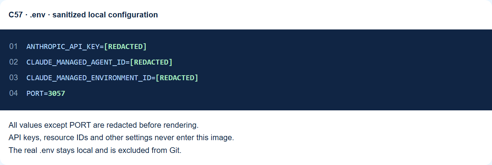

# C57 · Real-time Frontends and Multi-tenant SaaS

Executes a local multi-tenant session authorization and event projection. The demo identity is fixed server-side, not production authentication. Each run starts from a fresh local seed. The run journal stores results, not production workflow state.

## Student pages

- [What you will learn](https://github.com/luiscoco/Udemy-claude-managed-agents-lesson-c57-app/blob/main/public/guide.html#learning)
- [How to run this application](https://github.com/luiscoco/Udemy-claude-managed-agents-lesson-c57-app/blob/main/public/guide.html#run-guide)
- [Architecture, UML sequence diagram and code walkthrough](https://github.com/luiscoco/Udemy-claude-managed-agents-lesson-c57-app/blob/main/public/architecture.html)
- [Application lab source](https://github.com/luiscoco/Udemy-claude-managed-agents-lesson-c57-app/blob/main/public/index.html)
- [Sequence diagram](https://github.com/luiscoco/Udemy-claude-managed-agents-lesson-c57-app/blob/main/public/architecture.svg)

These GitHub links open source files. Start the Node application to use the rendered pages and navigation buttons. GitHub Pages cannot run this application's backend.

## Concepts students will learn

- Authorize the session before opening a stream
- Public event projection
- Tenant labels alone are not isolation

## Configure and run

Use Node.js 24 or later. In PowerShell, from this repository's folder:

```powershell
node --version
npm ci
Copy-Item .env.example .env
notepad .env
```

No API key is required for the local experiment. Optional live commentary requires your own API key, agent ID and environment ID. It explains the local result; it does not activate the integration discussed in the lesson.

For the optional live path, set your API key, then run npm run setup if you do not already have resource IDs. The script creates the environment before a text-only agent, saves each ID immediately, and reuses IDs already configured. It uses CLAUDE_MODEL or the source default; choose a model available to your account. An uncertain network failure may have created a resource: inspect your account before retrying.

```powershell
npm start
```

Open `http://127.0.0.1:3057`. Navigation leads to `/guide.html#learning`, `/guide.html#run-guide`, `/architecture.html`, and the application lab. If you change `PORT`, use the configured port. Keep the terminal running; stop with Ctrl+C. `npm run dev` also starts the web application.

Select the first scenario, inspect its editable fields, press Run experiment, and compare the outcome and evidence with the table above. Select another scenario to investigate the boundary condition.

## Create your .env file

Copy `.env.example` to `.env` and enter your own values. Do not commit the real file. Restart the server after editing it. The example contains safe placeholders; optional settings may be left blank to use source defaults. Resource IDs and keys stay on the server.

```dotenv
ANTHROPIC_API_KEY=your_api_key
CLAUDE_MANAGED_AGENT_ID=your_agent_id
CLAUDE_MANAGED_ENVIRONMENT_ID=your_environment_id
PORT=3057
```

The snapshot below uses the current local file's variable names. Every non-PORT value, including IDs, is redacted **before** rendering the image.



Regenerate it locally with `python scripts/capture-env-example.py` after installing Python Playwright and its Chromium browser. This optional documentation tool is not needed to run the app.

## How the application was developed

The browser collects inputs; the Node host validates requests; the lesson implementation produces observable evidence. The architecture page walks through the real source with numbered steps, prerequisite configuration, source filenames and code excerpts.

### Lesson implementation

[src/lesson.ts](https://github.com/luiscoco/Udemy-claude-managed-agents-lesson-c57-app/blob/main/src/lesson.ts)

```typescript
  async run(input) {

if(text(input,"sessionKey")!=="owned")return report("rejected","Unknown or unauthorized session",{authorized:false},["Use the host-owned principal","Check tenant and reader binding before opening"]);
const type=text(input,"eventType"),projected=type==="agent.message"?{type:"answer",text:text(input,"message")}:type==="session.status_idle"?{type:"idle",reason:"end_turn"}:null;
return report("passed","Applied the public event projection after authorization",{authorized:true,projected,rawInternalRecordForwarded:false},["Authorize the conversation","Project only public fields","Render text safely","Keep disconnect separate from remote stop"]);

  }
};
```

Read the architecture page for the remaining source excerpts and explanations, including input handling and optional provider behavior. The diagram describes this application, rather than implying that an external integration has been implemented.

## Validation

```powershell
npm test
python scripts/verify-walkthrough.py
```

The source hash check detects when walkthrough excerpts need refreshing. Browser verification covers page navigation, readable text, mobile layout, dark mode, diagram and image routes. Local scenarios and live provider calls are recorded separately in the workspace verification report; local success is not evidence of a live provider operation.

## Repository contents

Application sources, student web pages, safe configuration example and documentation images are included. `node_modules`, `presentation`, `output`, `reviewed`, `v3`, `teaching-material`, build output, local journals, credentials and local resource files are ignored. Existing teaching videos and presentations remain in the original workspace.
